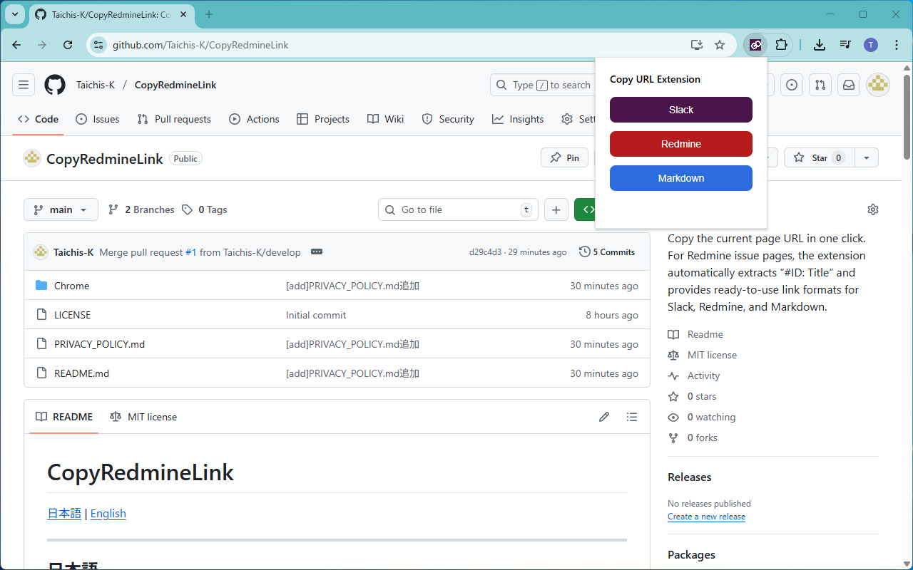

# CopyRedmineLink

[日本語](#日本語) | [English](#english)

---

## 日本語

ワンクリックでURLをコピーできるChrome拡張機能。Redmineのチケットページでは「#番号: タイトル」を自動抽出し、Slack・Redmine・Markdown形式で簡単に共有できます。



### 🎯 機能

#### 3つのコピー形式
- **Slack**: リッチテキストリンクとして表示される形式
- **Redmine**: Wiki記法 `"タイトル":URL` 形式
- **Markdown**: `[タイトル](URL)` 形式

#### Redmine自動認識
- チケットページを自動検出
- 「#番号: タイトル」を抽出
- プロジェクト名などの余分な情報を除去

### 📦 インストール

#### Chrome ウェブストア - 拡張機能
[Chrome ウェブストア - 拡張機能からインストール](https://chromewebstore.google.com/detail/copy-url-for-slack-redmin/hboceemaeifahfmnpeghilmclnbnkpbg)

#### 開発者向けインストール
1. このリポジトリをクローン
2. Chromeで `chrome://extensions/` を開く
3. 「デベロッパーモード」を有効化
4. 「パッケージ化されていない拡張機能を読み込む」をクリック
5. `Chrome/CopyRedmineLink` フォルダを選択

### 🚀 使い方

1. 任意のウェブページを開く
2. 拡張機能アイコンをクリック
3. 希望のフォーマットボタンを選択
4. クリップボードにコピー完了！

#### Redmineページでの動作例

**元のタイトル**
```
#1234: ユーザー認証機能の改善 - プロジェクト - Redmine
```

**コピー結果**
- Slack: `・1234: ユーザー認証機能の改善` （リンク付き）
- Redmine: `"#1234: ユーザー認証機能の改善":https://redmine.example.com/issues/1234`
- Markdown: `[#1234: ユーザー認証機能の改善](https://redmine.example.com/issues/1234)`

---

## English

A Chrome extension that copies URLs with one click. For Redmine issue pages, it automatically extracts "#ID: Title" and formats it for easy sharing in Slack, Redmine, and Markdown.


### 🎯 Features

#### Three Copy Formats
- **Slack**: Rich-text link format
- **Redmine**: Wiki syntax `"Title":URL` format
- **Markdown**: `[Title](URL)` format

#### Smart Redmine Detection
- Automatically detects issue pages
- Extracts "#ID: Title" pattern
- Removes unnecessary project names and metadata

### 📦 Installation

#### Chrome Web Store
[Install from Chrome Web Store](https://chromewebstore.google.com/detail/copy-url-for-slack-redmin/hboceemaeifahfmnpeghilmclnbnkpbg)

#### Developer Installation
1. Clone this repository
2. Open `chrome://extensions/` in Chrome
3. Enable "Developer mode"
4. Click "Load unpacked"
5. Select the `Chrome/CopyRedmineLink` folder

### 🚀 Usage

1. Open any webpage
2. Click the extension icon
3. Select your desired format button
4. Copied to clipboard!

#### Example on Redmine Page

**Original Title**
```
#1234: User Authentication Improvement - Project - Redmine
```

**Copy Results**
- Slack: `・1234: User Authentication Improvement` (with link)
- Redmine: `"#1234: User Authentication Improvement":https://redmine.example.com/issues/1234`
- Markdown: `[#1234: User Authentication Improvement](https://redmine.example.com/issues/1234)`

---

## 🔒 Privacy / プライバシー

- All processing happens locally / すべての処理はローカルで実行
- No external server connections / 外部サーバーへの通信なし
- No user data collection / ユーザーデータの収集なし
- No browsing history tracking / 閲覧履歴の追跡なし

See [Privacy Policy](PRIVACY_POLICY.md) for details.

## 🌐 Supported Languages / 対応言語

- English
- 日本語 (Japanese)

## 📝 License / ライセンス

MIT License - See [LICENSE](LICENSE) for details.

## 🤝 Contributing / 貢献

Issues and pull requests are welcome! / Issue報告やプルリクエストを歓迎します！

## 📧 Contact / お問い合わせ

For issues or suggestions, please use [GitHub Issues](https://github.com/Taichis-K/CopyRedmineLink/issues).